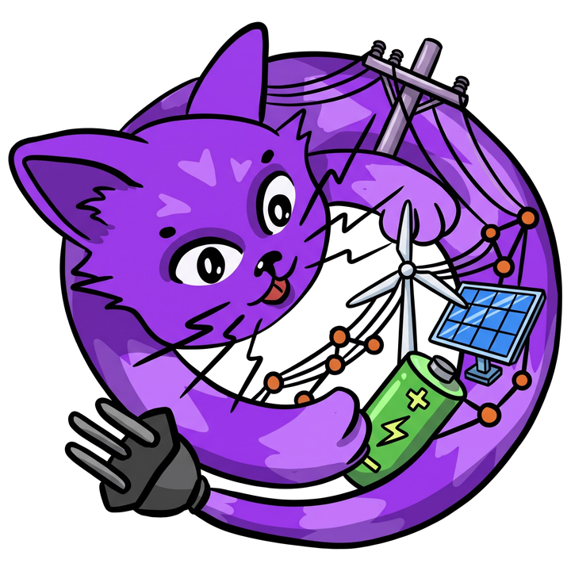

<p align="center">
  
  <br/>
</p>

<p align="center" style="font-size: 25px;">
    <b>gridfm-datakit-distr</b>
</p>


---

# gridfm-datakit-distr

**gridfm-datakit-distr** is a Python library for generating machine-learning datasets of power
flows and optimal power flows in **three-phase unbalanced distribution networks**: MV and LV,
including European four-wire LV feeders with an explicit neutral. It is the distribution
counterpart of [gridfm-datakit](https://github.com/gridfm/gridfm-datakit).

> Developed by the Energy and Environment department of [Vicomtech](https://www.vicomtech.org),
> maintained by Carmine Delle Femine ([@cardef](https://github.com/cardef)). Copyright 2026 Vicomtech, released under the [Apache License 2.0](LICENSE); see [NOTICE](NOTICE).

## Unique Features

* **Three-phase truth per conductor**: OpenDSS (through [DSS-Extensions](https://dss-extensions.org/))
  solves the full model, neutral included. Networks are compiled by OpenDSS itself, never
  re-parsed. Every node gets its voltage, and the admittance of every element and of the network
  is stored, so currents, flows and injections follow exactly.
* **Real distribution networks**: IEEE test feeders, the IEEE European LV feeder, 128 four-wire
  ENWL LV feeders (CSIRO) and EDP's MV/LV networks. They are downloaded with checksums, each
  carries a passport (provenance, licence, recipe), and every network in use passes a conformance
  suite (convergence, Kirchhoff residual, admittance consistency, phases, neutral, golden files).
* **Structural variants**: line lengths, neutral impedances, earthing resistances, phases of
  single-phase customers, rooftop PV placement and size.
* **Operating scenarios**: synthetic or measured load profiles, PV output from time of day and
  cloud cover, source voltage, regulator taps and capacitor states settled per scenario from
  jittered starting taps.
* **Physics-checked labels**: a power flow counts as converged only if every load and generator
  delivers its setpoint; a sample gets the full Kirchhoff residual check; failures are recorded,
  never dropped.
* **OPF labels**: optionally, the minimum-cost unbalanced AC OPF of every scenario, with the PV
  units as controls, solved with Ipopt (through CasADi) on the stored admittances; each dispatch
  is verified in OpenDSS.
* **Compact, reproducible outputs**: Parquet tables per variant, network state and scenario, with
  Croissant metadata. The same config and seed give the same bytes, whatever the number of
  processes. 10⁶ snapshots of CSIRO LV feeders: about 0.3 h on 32 cores and 60 GB
  (extrapolated from 10⁵).
* **[gridfm-graphkit](https://github.com/gridfm/gridfm-graphkit)**: `export-posseq` writes the
  positive-sequence equivalent of a dataset in gridfm-datakit's format, readable by GENCO.

---

# Installation

1. Make sure you have Python 3.10, 3.11 or 3.12.

2. Install gridfm-datakit-distr (the repository is private for now: you need access to it)

    ```bash
    pip install "gridfm-datakit-distr @ git+ssh://git@github.com/gridfm/gridfm-datakit-distr.git@v0.2.0"
    ```

3. Optional: OPF labels (CasADi with its bundled Ipopt)

    ```bash
    pip install "gridfm-datakit-distr[opf] @ git+ssh://git@github.com/gridfm/gridfm-datakit-distr.git@v0.2.0"
    ```

4. Optional: Julia with PowerModelsDistribution, used only to cross-check the OPF

    ```bash
    pip install "gridfm-datakit-distr[julia] @ git+ssh://git@github.com/gridfm/gridfm-datakit-distr.git@v0.2.0"
    gridfm_datakit_distr setup-julia
    ```

### For Developers

With [uv](https://docs.astral.sh/uv/) (creates `.venv` and installs the versions pinned in
`uv.lock`):

```bash
git clone git@github.com:gridfm/gridfm-datakit-distr.git
cd gridfm-datakit-distr
uv sync
uv run pytest -m "not slow and not julia"
```

More in the [installation guide](docs/installation.md): extras, tests, network shares.

# Getting Started

The [getting started guide](docs/manual/getting_started.md) goes from an empty machine to reading
voltages, admittances and flows in Python.

### Fetch Networks

Download catalog networks into the cache, with checksum verification:

```bash
gridfm_datakit_distr fetch ieee13 csiro_enwl edp
```

### Generate Data

Estimate the size and time, then generate:

```bash
gridfm_datakit_distr generate scripts/config/ieee13_small.yaml --dry-run
gridfm_datakit_distr generate scripts/config/ieee13_small.yaml --data-dir data
```

Running the same command again resumes an interrupted dataset.

With the `opf` extra, `scripts/config/opf_small.yaml` also labels every scenario with its optimal
power flow: see [OPF labels](docs/manual/opf.md).

### Validate Networks

Run the conformance suite on catalog networks:

```bash
gridfm_datakit_distr validate ieee13 csiro_enwl/n01_f1
```

### Compute Statistics

Distributions of phase and neutral voltages, voltage unbalance, loadings and violation rates:

```bash
gridfm_datakit_distr stats data/ieee13_small [--plots]
```

### Export for gridfm-graphkit

Write the positive-sequence equivalent in gridfm-datakit's layout (`<out>/<network_id>/raw` is
graphkit's `data_path`):

```bash
gridfm_datakit_distr export-posseq data/ieee13_small --out data/ieee13_small_posseq
```

## Configuration Overview

The [configuration reference](docs/manual/config.md) lists every key with its default; see also
[Variants](docs/manual/variants.md) and [Scenarios](docs/manual/scenarios.md). Sample
configurations are in `scripts/config`, e.g. `default.yaml`:

```yaml
# A commented starting point; every value set here is the default (a test checks it);
# every key and its default is in docs/manual/config.md.
dataset_name: my_dataset # directory under settings.data_dir

networks:
  include: [ieee13] # catalog ids or glob patterns, e.g. csiro_enwl/n01_*
  neutral_representation: explicit # explicit | kron | as_is

variants:
  n_variants: 4 # perturbed copies of each network
  admittance:
    line_length_scale: {distribution: uniform, low: 0.9, high: 1.1} # one factor per line
    neutral_impedance_scale: 1.0 # factor on the neutral impedances of four-wire lines
    grounding_resistance_ohm: null # null keeps the source's earthing resistances
  phase_reallocation:
    enabled: true # moves a share of single-phase customers to another phase
    fraction: 0.2 # share of single-phase customers moved to another phase

der:
  pv:
    penetration: {distribution: uniform, low: 0.0, high: 0.8} # share of customers with PV, per variant
    kwp: {distribution: uniform, low: 2.0, high: 6.0} # peak power of each system (kW)
    power_factor: 1.0

scenarios:
  n_scenarios_per_variant: 1000
  source_voltage_pu: {distribution: uniform, low: 0.98, high: 1.05}
  profiles:
    provider: synthetic # synthetic | network_loadshapes | edp_smart_meter
    synthetic:
      global_scale: {distribution: uniform, low: 0.2, high: 1.2} # factor on every load, per scenario
      local_sigma: 0.3 # lognormal noise on each customer's load
  pv_profile:
    cloudiness: {distribution: uniform, low: 0.0, high: 1.0} # one cloud cover per scenario

controls:
  mode: static_settle # settle regulators and capacitors, jitter the taps, settle again, freeze
  tap_jitter_steps: 2

labels:
  element_currents: false # true also stores every element's current (otherwise Yprim · V)

views:
  kron: false # true also re-solves each scenario without the neutral (Kron reduction)

settings:
  seed: 42 # same config and seed: same dataset, bit for bit
  data_dir: ./data
  num_processes: null # null: one per core
  chunk_size: 500 # scenarios per output part
  float_precision: mixed # mixed: float64 voltages, float32 currents and setpoints
```

<br>

## Output Files

A dataset is written to `{settings.data_dir}/{dataset_name}`; every table and column is in
[Outputs](docs/manual/outputs.md).

- **manifest.json**: the resolved config, its hash, the engine versions and the status of every
  work unit (for resume).
- **README.md**, **croissant.json**: the dataset card and its Croissant 1.0 metadata.
- **catalog/**: the networks, with their passports.
- **variants/**: per variant, the nodes (one per conductor), the elements and their terminals, the
  primitive admittances, a semantic layer aligned with PowerModelsDistribution.
- **states/**: per network state (taps, capacitor steps), the network admittance matrix and the
  state-dependent primitive admittances.
- **scenarios/**: per scenario, the metadata and status, the node voltages, the load and DER
  setpoints (and, if asked, every element's current).
- **views/kron/**: if asked, the network without its neutral, re-solved per scenario.
- **opf/**: with `labels.opf.enabled`, per scenario the OPF status, the PV dispatch and the node
  voltages.
- **stats/**: the statistics written by `stats`.

# TODO

- [ ] Storage, dispatchable generators and wind units, in the scenarios and as OPF controls (the
  OPF controls the PV units only).
- [ ] PV availability per unit (orientation, shading, units off) and PV output from irradiance
  data by location and date.
- [ ] More variability, ordered by how much each moves the labels: unbalanced source voltage,
  multiple earthing of the neutral, upstream network strength, voltage-dependent (ZIP) loads, a
  factor shared by the line lengths of a feeder, inverter volt-var and volt-watt.
- [ ] OPF on IEEE 37, the one catalog network it does not cover.
- [ ] Evaluation protocol for power flow and OPF: metrics, data splits (held-out variants, feeders
  and sources) and baselines.
